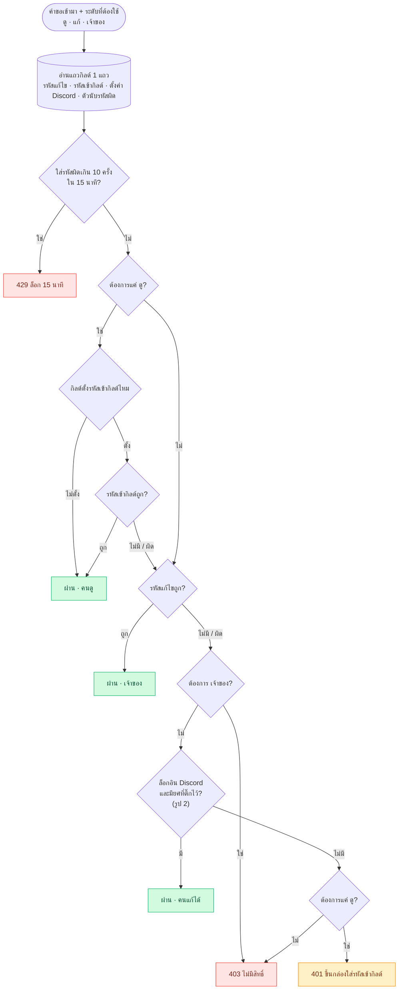
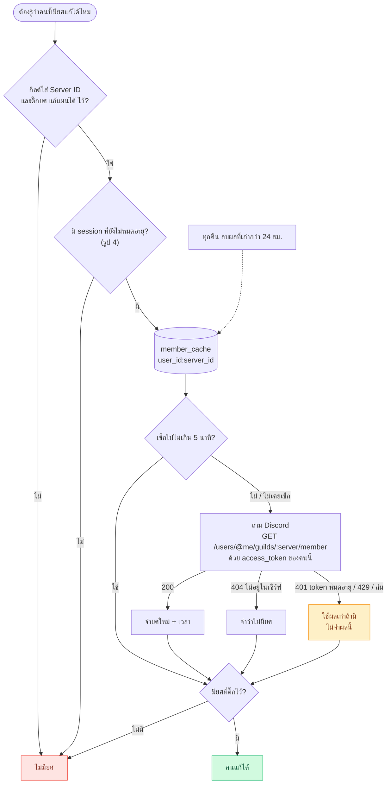
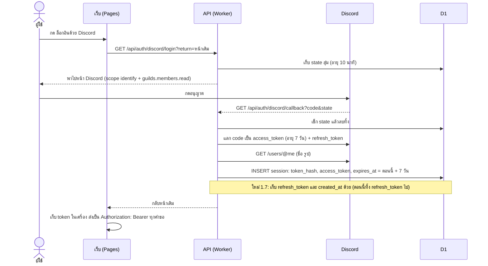
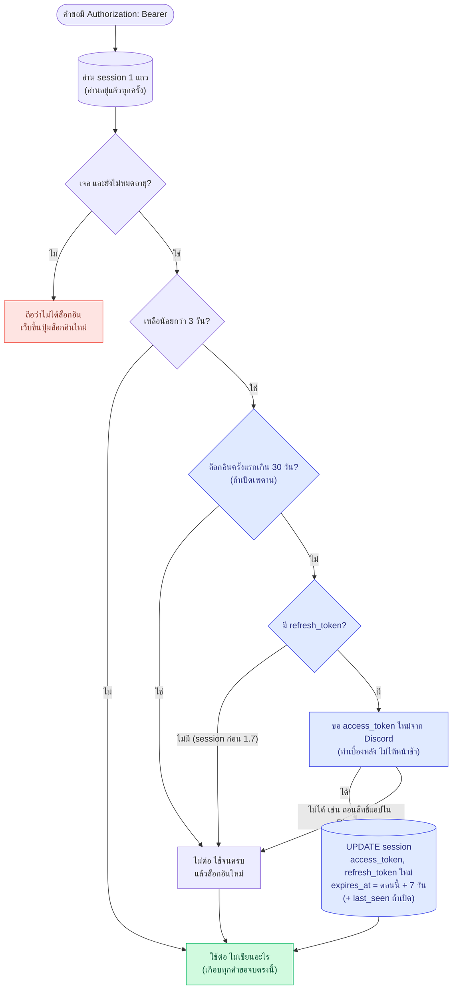
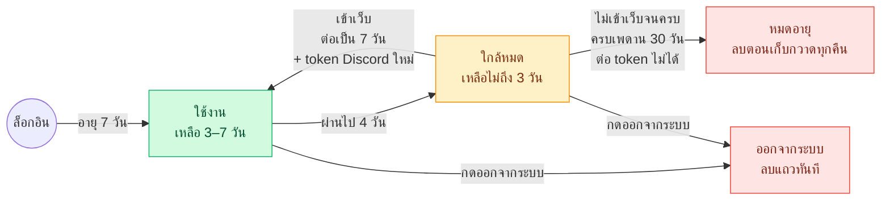
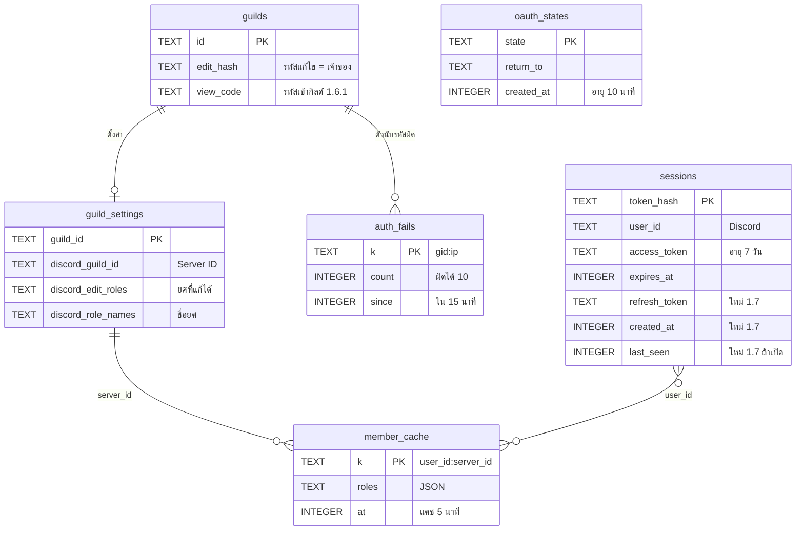

# ระบบสิทธิ์และล็อกอิน (1.7)

แผนภาพ Mermaid (GitHub/VS Code แสดงเป็นรูปให้เอง) · โค้ดอยู่ใน `api/src/index.ts` (checkAuth / viewGate / currentUser / touchSession) · เทสต์ `api/tests/view-lock.mjs`, `owner.mjs`, `session.mjs`

แก้ระบบเหล่านี้เมื่อไหร่ ให้แก้แผนภาพในไฟล์นี้ด้วย

## 1 · ใครทำอะไรได้ในหน้ากิลด์ (แบบสิทธิ์เดียว 1.7)

ทุกคำขอบอกระดับที่ต้องใช้ (ดู / แก้ / เจ้าของ) แล้วเช็กทางที่ถูกที่สุดก่อน ยังอ่านฐานข้อมูลแค่ 1 แถวต่อการเปิดหน้า

โค้ด: ดู = `viewGate` · แก้ = `checkKey` · เจ้าของ = `checkOwner` (ทั้งหมดผ่าน `checkAuth`) · ตัวนับรหัสผิดแยกกัน 2 ชุด: รหัสเข้ากิลด์ กับ รหัสแก้ไข — คนแก้ผ่านได้แม้ IP นั้นโดนล็อกเพราะใส่รหัสเข้ากิลด์ผิด

## 2 · เช็กยศ Discord (คนแก้ได้)

กล่องสีเหลือง: ถ้า token Discord หมดอายุ Discord ตอบ 401 แล้วคนแก้ได้จะกลายเป็นคนดูเงียบ ๆ — เพราะแบบนี้ตอนต่ออายุ session (รูป 4) ต้องขอ token Discord ใหม่ไปพร้อมกันเสมอ

## 3 · ล็อกอินด้วย Discord

1.7 เก็บ refresh_token, created_at และ last_seen ไว้ใน session ด้วย

## 4 · เช็ก session + ต่ออายุ (ใหม่ 1.7)

กล่องสีน้ำเงินคือของใหม่ 1.7 · เกือบทุกคำขอจบที่ “ใช้ต่อ ไม่เขียนอะไร” · ต่ออายุ ~4 วันครั้งต่อคน + จด last_seen วันละครั้ง (หน้า admin) · คำขอพร้อมกันหลายอันจองด้วย last_seen ก่อน ขอ token Discord ได้ทีละครั้ง · Discord ตอบ 400/401 = เลิกต่อ ใช้จนหมดแล้วล็อกอินใหม่

## 5 · ชีวิตของ session ล็อกอิน

คนที่เข้าเว็บอย่างน้อยทุก 7 วันจะไม่หลุด (จนครบเพดาน 30 วัน ถ้าเปิด)

## 6 · ตารางที่เกี่ยวข้อง

view_code มาจาก 1.6.1 (migration 0031) · 3 คอลัมน์ “ใหม่ 1.7” ใน sessions มาจาก migration 0032_session_renew

